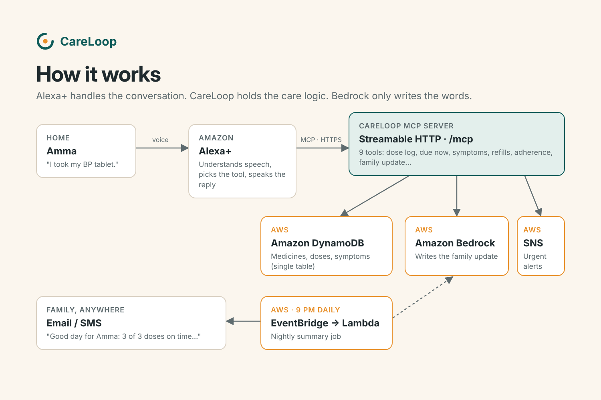

# CareLoop 💊🔁

**An Alexa+ MCP server that helps aging parents manage their medicines by voice, and keeps distant family in the loop.**

Built for the *Build, Ship, Shape: Amazon Developer Hackathon*. Track: **Alexa+**. Mini challenge: **AWS Builder** (Amazon Bedrock, DynamoDB, Lambda, SNS, EventBridge).

---

## The problem

Millions of older adults live far from their children. Missed tablets, double doses and slowly worsening symptoms often go unnoticed until they become emergencies. Apps with small buttons don't work well for many older people, but **talking** does, and Alexa is already in their homes.

## What CareLoop does

| Person says | Tool | Alexa replies |
|---|---|---|
| "The doctor gave me Metformin 500 for sugar, twice a day after meals. 30 tablets." | `add_medication` | "Okay. I've added Metformin 500mg at 9 AM and 9 PM. You have 30 left." |
| "What do I need to take now?" | `whats_due_now` | "Right now, please take: Amlodipine 5mg, Metformin 500mg (after food)." |
| "I took my BP tablet." | `log_dose_taken` | "Got it. Amlodipine for 8 AM is done. Well done!" |
| "I took my BP tablet." *(again, by mistake)* | `log_dose_taken` | "You've already taken all of today's Amlodipine. Please don't take another dose unless your doctor told you to…" |
| "I'm feeling dizzy." | `log_symptom` | Notes it, and spots that it's the 3rd time this week. |
| "I have chest pain." | `log_symptom` | "This could be serious. Please call 112 for emergency help right now…" and alerts family by SMS/email. |
| *(Family)* "How is Amma doing today?" | `daily_summary_for_family` | A short, calm update written by **Amazon Bedrock**. |

Also: `refill_alert`, `adherence_report`, `list_medications`, `remove_medication`.

### Design choices that matter for voice
- **Spoken schedules, not forms.** "twice a day after meals", "morning and night" and "8am and 8:30 pm" all become clock times (`careloop/timeparse.py`).
- **Loose names.** "my BP tablet", "sugar pill" and misspellings resolve to the right medicine through purpose, nicknames and fuzzy matching.
- **Safety first.** A double-dose guard, emergency warning-sign detection, and no medical advice beyond what the tools state.
- **Every tool returns a `say` field** written to be read aloud, plus structured data for anything else.
- **Bedrock writes, code decides.** All facts (adherence, misses, symptoms, refills) are computed deterministically. Bedrock only turns them into a warm message. If Bedrock is unavailable, a template writes the summary so nothing breaks.

## Architecture



- **MCP server:** Python MCP SDK 2.x (`MCPServer`), **Streamable HTTP** at `/mcp`, protocol `2026-07-28` (later than the required 2025-11-25). Stateless mode, so it scales horizontally.
- **Storage:** DynamoDB single-table design (`pk = USER#id`, `sk = MED#… | DOSE#… | SYMPTOM#…`), or SQLite for local development.
- **Amazon Bedrock** (Converse API, default `amazon.nova-lite-v1:0`) writes family summaries.
- **AWS Lambda + EventBridge** send the nightly summary. **Amazon SNS** delivers it, along with urgent alerts, by email or SMS.

```
careloop/
  server.py      MCP tools + Streamable HTTP app (+ optional bearer auth, /health)
  core.py        care logic: matching, dose slots, safety checks, adherence
  timeparse.py   spoken schedule -> clock times
  store.py       DynamoDB and SQLite backends
  summary.py     Bedrock family summary (+ template fallback)
  notify.py      SNS family alerts
  daily_job.py   Lambda handler for the nightly summary
  assistant.py   Alexa+ stand-in for the web demo (Bedrock agent or phrase router)
  demo_data.py   a realistic past week for demos
streamlit_app.py      web demo (simulated Alexa+ + family view)
infra/template.yaml   AWS SAM: DynamoDB, SNS, Lambda, EventBridge schedule
scripts/              demo conversation client, demo data seeder
tests/                pytest suite
```

## Web demo (simulated Alexa+ experience)

`streamlit_app.py` is a browser version of the Alexa+ conversation. Every message goes through a real MCP client session to the CareLoop server, and the right-hand panel shows the family's view. A demo clock lets you jump to the evening to see missed doses and the family update.

```bash
streamlit run streamlit_app.py
```

Set `BEDROCK_MODEL_ID` (plus AWS credentials) and the assistant becomes an Amazon Bedrock tool-use agent that reads the MCP tool list and picks tools itself, the same role Alexa+ plays. Without it, a built-in phrase router is used.

## Quick start (local, about 2 minutes)

```bash
pip install -e ".[dev]"
python -m pytest -q                          # 8 tests
python -m careloop.server                    # MCP server on http://localhost:8000/mcp
```

In a second terminal:

```bash
python scripts/demo_conversation.py          # plays a full day over real MCP Streamable HTTP
```

Optional demo history (a week with a recurring symptom and missed doses):

```bash
CARELOOP_DB=demo.db python scripts/seed_demo_week.py
CARELOOP_DB=demo.db python -m careloop.server
```

Inspect the tools interactively with the MCP Inspector:

```bash
npx @modelcontextprotocol/inspector     # choose "Streamable HTTP", URL http://localhost:8000/mcp
```

## Configuration

| Variable | Purpose | Default |
|---|---|---|
| `CARELOOP_TABLE` | DynamoDB table (uses SQLite if unset) | – |
| `CARELOOP_DB` | SQLite path | `careloop.db` |
| `BEDROCK_MODEL_ID` | Bedrock model for summaries | template only |
| `AWS_REGION` | AWS region | `us-east-1` for Bedrock |
| `CARELOOP_SNS_TOPIC_ARN` | Family alerts topic | log only |
| `CARELOOP_PERSON_NAME` | How the family refers to the person | `Amma` |
| `CARELOOP_TZ` | Person's time zone | `Asia/Kolkata` |
| `CARELOOP_EMERGENCY_NUMBER` | Local emergency number | `112` |
| `CARELOOP_API_KEY` | Require `Authorization: Bearer <key>` on `/mcp` | open |
| `CARELOOP_ALLOWED_HOSTS` | Enable DNS-rebinding protection for these hosts | off |
| `CARELOOP_NOW` | Pin the clock (demos/tests), e.g. `2026-10-18T09:10` | real time |

## Deploying and connecting to Alexa+

See [docs/DEPLOY.md](docs/DEPLOY.md).

## Disclaimer

CareLoop is a reminder and journaling tool, not a medical device. It does not give medical advice. In an emergency, call your local emergency number.

## License

MIT, see [LICENSE](LICENSE).
